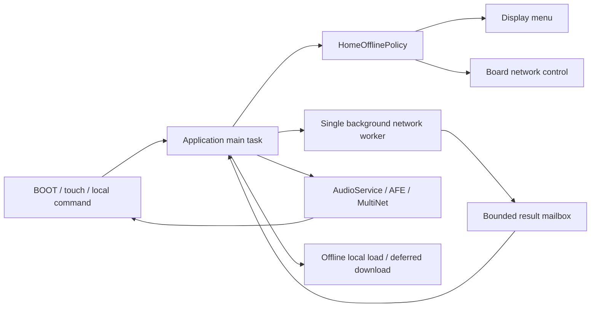

# 家用离线交互实现设计

逻辑基线：2.6.0；需求文档统一位于 docs/home-offline/，不引入发布目录。
行为来源：[规格](spec.md)及[已确认方案](proposal.md)。

## 目标与边界

实现 HOME 的离线启动、恢复、菜单和固定指令；不烧录、不改变其他板型默认行为、引脚或协议线上格式。

## 架构

模式选择、菜单、期限和恢复结果在主任务归并。阻塞 HTTP、协议握手及资源更新在后台执行；
每类任务至多一个在途请求，用 generation 标记取消，迟到结果只释放资源。
实际会话协议用共享所有权跨后台建连存活；所有应用回调在主任务核对 epoch 后执行。
恢复探测使用独立临时协议实例，不注册业务回调；实际会话初始化不复用探测的回调或音频。

## 接口契约

接口服务于上述五类行为；具体实现可在不改变语义时补充私有字段。

| 边界 | 签名与语义 |
| --- | --- |
| Board 网络 | `virtual bool SetNetworkEnabled(bool enabled)`、`virtual bool RequestWifiConfiguration()`、`virtual bool IsNetworkConnected() const`；默认不支持。HOME 实现初始化后停止／开启 STA 或配网，禁用时先屏蔽 ConfigModeExit 自动重连 |
| 网络后台 | `bool HomeNetworkService::StartRecovery(uint64_t generation)`；`bool TakeResult(Result&)` 一次取走结果；`bool Busy() const`；`void Invalidate(uint64_t generation)` 使旧工作失效。Busy或尚有未取结果时拒绝新请求，返回false；generation须非零。Result类型见下文，不返回仍使用栈回调的临时协议 |
| 本地音频 | `bool AudioService::HasLocalCommands()`；`bool StartLocalCommands(uint64_t generation)`；`void StopLocalCommands()`；回调 `on_local_command(const std::string& action, uint64_t generation)`。不可用返回 false，停止同步废弃旧识别，应用窗口 generation 再做第二道检查 |
| 资源音频 | `bool AudioService::PrepareForAssetUpdate()` 停止采集并等待任务退出／停止访问模型；`void ResumeAfterAssetUpdate()` 重建必要引擎，失败保持无本地语音；后台调用，主任务更新期间不调音频控制 |
| 菜单显示 | `virtual void ShowNetworkMenu(const std::vector<std::string>& items, int selected)`；空列表关闭；`virtual int NetworkMenuHitTest(int x,int y)` 返回项目下标或 -1；默认无操作／-1，所有 LVGL 访问加锁 |
| 显示资源屏障 | `virtual bool Display::PrepareForAssetUpdate()` 在显示锁内停止GIF/预览、解除图像及动态字体引用并切换内置基础界面；不支持安全释放则返回false，禁止写资源。可重复调用；T3实现，T4与音频屏障一起调用后才让T2资源写入 |
| 应用输入 | `void NetworkMenuPressed()` 长按事件；`bool HandleHomeTouch(int x,int y)` 由主任务处理菜单触点，返回是否消费；板级任务只采集和 Schedule，不直接修改应用状态 |

本地动作使用稳定 action：screen_on、screen_off、volume_up、volume_down、brightness_up、brightness_down、device_status、cancel。
wake 仍是独立 action，不能在命令窗口外执行设备动作。默认不含 MultiNet 的资源诚实报告无本地指令；独立家用资源包包含完整词表。

## 数据与错误处理

- `HomeNetworkService::Result`：`uint64_t generation=0; bool ready=false; bool use_mqtt=false; bool has_server_time=false; std::string activation_message; std::string error;`。ready仅指proposal第3.1节控制/hello（有UDP探测时还含PONG）通过，不表示媒体全链正常。取消结果也携带原generation且ready=false；主任务只消费当前generation。use_mqtt仅在配置解析成功后有效，ready=false不安装实际会话协议。
- Invalidate不强制杀死阻塞驱动调用，而使工作在下一个I/O边界停止并拒绝发布成功；结果邮箱容量1，析构等待后台任务退出。临时协议及其回调上下文存活到协议销毁完成，回调不捕获已退出的栈变量。
- generation由应用主任务递增，每次模式取消、断网或新配置后调用Invalidate；StartRecovery拒绝时不改变已有任务/邮箱，TakeResult取空返回false且不修改输出参数。
- 资源成功写入后由`Assets::Apply()`重绑定字体/图像，音频ResumeAfterAssetUpdate重新初始化模型；失败继续基础界面。音频或显示任一Prepare失败都禁止UnApplyPartition/Download，保持资源有效性并反馈失败；屏障与重绑定顺序列入host验证。
- `home/offline`：新增 int32 设置，0=允许联网，1=手动离线；缺失默认0，checked写失败须提示未保存。
- 纯逻辑策略保存 Online/AutomaticOffline/ManualOffline、menu、selected、command_generation、deadline_ms 和 retry_delay_ms；与暂停监听独立。
- 命令窗口与后台任务使用单调时钟和非零 generation，取消后结果不匹配即丢弃。
- 网络配置或激活未完成：返回错误/激活说明，保持本地能力并重试；不自动安装固件。
- 无显示、无背光或能力不支持：返回失败而不是空指针解引用；状态查询保留 unknown。
- 资源失败使用内置字体界面；释放旧模型/字体/图像引用后才允许解除映射或覆盖分区。
- 菜单内暂停监听选择即时保存到运行状态，退出不使用旧快照；初次长按不会确认默认返回项。

## 约束与取舍

沿用方案的 3/8/15/300 秒参数和音量亮度边界。事件邮箱与在途任务有界，网络等待不占用主任务。
复用单一 AFE 采集，不新增第二路采集。探测只允许 hello/协商探测包，无用户音频、播放或设备动作。
替代方案“沿用 service_state==available 恢复”会等待媒体证据而循环；“直接执行 JSON 工具调用”混淆云端和本地授权，均不采用。

## 测试策略与阶段

纯策略／窗口／动作／菜单做 host C++ 回归；音频 action 分发和资源词表做 Python 驱动的 host 测试；
网络覆盖 WS、MQTT 无探测和有探测三种证据，验证取消、配网退出及原有协议测试。
共享接口需保留非 HOME 路径。先完成并审查本文接口，再并行实施互不重叠模块，主代理整合应用。
最后运行 scripts/tests、HOME 构建、代表性非 HOME 构建及独立资源打包，实机项目单独报告未验证。
